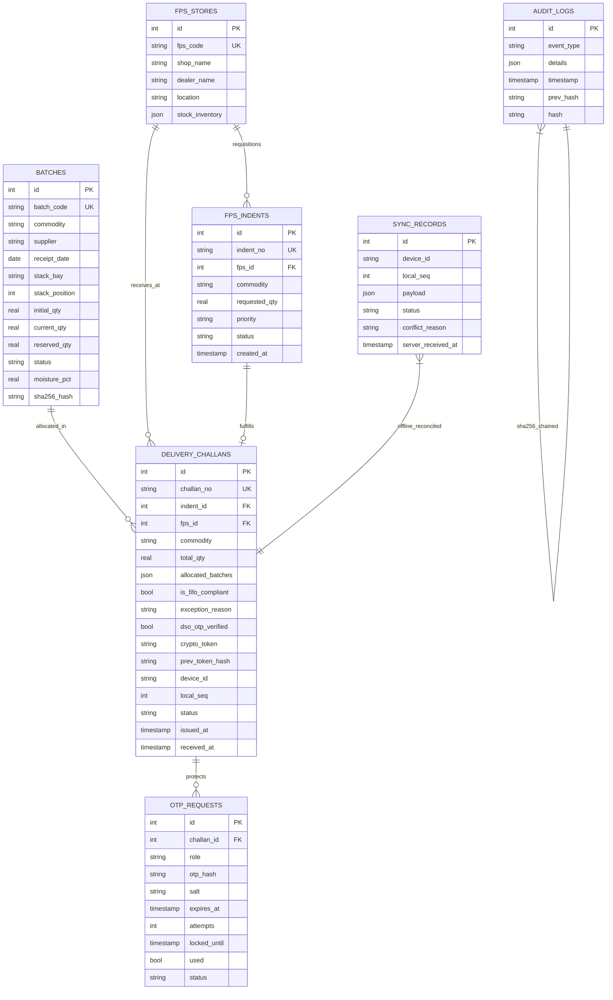

# AnnaSetu 3D
### Gautam Buddha Nagar iPDS Smart Commodity Stock Allocation & FIFO Management System
**Godown Location:** *Surajpur Central iPDS Godown, Greater Noida, Uttar Pradesh*  
**Problem Statement 4:** Public Distribution System (PDS) Commodity Allocation & Strict First-In-First-Out (FIFO) Enforcer

---

## 🏛️ Executive Summary & Core Mission
In fair price public distribution, grain spoilage, unauthorized stock rotation, and favoritism in dispatching fresher commodities over older inventory result in massive losses and lower quality rations for citizens. 

**AnnaSetu 3D** is a GovTech command and warehouse dispatch platform designed for the **Surajpur Central iPDS Godown**. It mathematically enforces strict First-In-First-Out (FIFO) allocation down to individual storage bays, provides cryptographically chained SHA-256 event integrity, and features real-time synchronization between the central godown command center and a simulated rugged worker handset.

---

## 🛠️ Technology Stack
- **Frontend Framework:** React 18 + Vite
- **Styling & Theme:** Tailwind CSS v3 (Industrial GovTech Dark Theme: Slate-950 background, Emerald-500 FIFO Compliant, Amber-500 Ageing, Rose-600 Violation)
- **Icons & Visuals:** `lucide-react`
- **Analytics & Visualizations:** `recharts` (Stock distribution and age profile graphs)
- **State Architecture:** React Context + pure `useReducer` with automatic `localStorage` synchronization
- **Audio Synthesizer:** Web Audio API (`AudioContext` sawtooth warning beeps, oscillating warehouse emergency sirens, and major-triad success chimes)
- **Backend Framework:** FastAPI + Uvicorn with SQLite (`backend.main:app`)
- **Testing:** Pytest + HTTPX (`npm run test:backend`)
- **Dual Runner:** Concurrently with `--kill-others-on-fail`

---

## 🚀 Environment Requirements & Run Steps

### Prerequisites
- **Python Version:** **Python 3.10+** (Tested and verified with **Python 3.14.7**)
- **Node.js Version:** **Node.js 18+** (Vite 5.4 compatible)
- **Package Managers:** `pip` and `npm`

### Quick Start (One-Click / Windows)
Double-click or run [start.bat](./start.bat):
```cmd
start.bat
```
This script automatically:
1. Installs Node dependencies if `node_modules` is missing.
2. Initializes Python virtual environment (`.venv`) if not present.
3. Activates `.venv` and installs packages from `requirements.txt`.
4. Runs `npm run dev` to start FastAPI backend on port 8000 and Vite frontend on port 3000.

### Manual Setup & Execution Steps
1. **Install Node dependencies:**
   ```bash
   npm install
   ```

2. **Configure Python virtual environment:**
   ```bash
   python -m venv .venv
   # Windows (PowerShell / Command Prompt):
   .venv\Scripts\activate
   # macOS / Linux:
   source .venv/bin/activate
   ```

3. **Install Python backend requirements:**
   ```bash
   pip install -r requirements.txt
   ```

4. **Run Frontend + Backend Concurrently:**
   ```bash
   npm run dev
   ```
   - **Frontend Web Portal:** `http://localhost:3000`
   - **FastAPI Backend:** `http://127.0.0.1:8000`
   - **FastAPI Interactive Docs:** `http://127.0.0.1:8000/docs`

5. **Run Backend Test Suite:**
   ```bash
   npm run test:backend
   # Or directly via pytest:
   pytest backend/tests -v
   ```

---

## 📐 Algorithmic Specifications

### 1. Pure FIFO Allocation Engine (`allocateFIFO`)
- **Filter**: Matches commodity, strictly requires `qualityStatus === 'Eligible'`, and requires `remainingQtl > 0`.
- **Exclusion**: Batches flagged with `"Hold - High Moisture"` are strictly ignored regardless of age.
- **Sort**: Sorted ascending by `receiptDate` (oldest first). Equal dates are deterministically tie-broken alphabetically by `batchId`.
- **Cascade**: Allocates $\min(\text{remaining}, \text{needed})$ per batch until fulfilled.
- **Shortfall Protection**: If total eligible stock is insufficient, dispatch is strictly blocked and exact shortfall is displayed.

### 2. Statutory Violation Definition
A manual selection is classified as a **FIFO Violation** if:
$$\exists \text{ selected batch } B_{\text{sel}} \text{ and eligible batch } B_{\text{older}} \text{ such that } \text{receiptDate}(B_{\text{older}}) < \text{receiptDate}(B_{\text{sel}}) \land \text{unpicked}(B_{\text{older}}) > 0$$
Any violation immediately triggers an audio alert, locks dispatch, and demands a signed **Approved Exception Form** (Reason, Gazetted Approving Officer, Justification Remarks).

### 3. FIFO Compliance Rate Formula
$$\text{FIFO Compliance \%} = \frac{\text{Compliant Dispatches}}{\text{Compliant Dispatches} + \text{Blocked Violations} + \text{Approved Exceptions}} \times 100$$

---

## 🧪 Acceptance Test Verification Matrix

| # | Acceptance Test Criteria | Verified Behavior |
|---|---------------------------|-------------------|
| **1** | Multi-batch split across 2+ batches | Wheat 120 Qtl splits across WH-102 (50 Qtl) + WH-103 (55 Qtl) + WH-104 (15 Qtl) in strict oldest-first order with exact remaining balances. |
| **2** | "Hold - High Moisture" batches skipped | Oldest Wheat batch WH-101 (75 days old, Hold) is visibly skipped by the engine. |
| **3** | Shortfall detection & block | Requesting 500 Qtl exceeds eligible stock, triggers red deficit banner and disables dispatch. |
| **4** | Manual newer batch violation modal | Picking newer WH-105 before older WH-104 triggers red alarm modal, demanding signed exception form. |
| **5** | Wrong-QR scan siren & zero stock change | Handset scanning wrong newer batch triggers oscillating Web Audio siren, flashes red alarm on both screens, and preserves stock unchanged. |
| **6** | Correct scan & live updates | Multi-step sequential handset picking (`1/3` ➜ `2/3` ➜ `3/3`) updates KPIs, batch table, and SHA-256 ledger without page refresh. |
| **7** | Persistence & Demo Reset | Page reload retains all dispatches and exceptions; "Reset Demo Data" restores relative seed data. |

---

## 🎯 3 Demo Steps for Judges (Live Walkthrough)

Follow these 3 simple steps to see the entire system in action:

### Step 1: Automatic Multi-Batch Split & Moisture Hold Skip
1. In the top header, click the **"Load Demo Scenario (120 Qtl)"** button.
2. In the **Smart FIFO Batch Split Diagram**, observe:
   - Oldest Wheat batch **`#WH-101` (75 days old)** is on *"Hold - High Moisture"* and is **automatically skipped**!
   - Stock is cascadingly taken from:
     - **Batch `#WH-102` (55 days old in Bay A2)**: Takes 50 Qtl (Exhausted: 0 Qtl left)
     - **Batch `#WH-103` (45 days old in Bay A3)**: Takes 55 Qtl (Exhausted: 0 Qtl left)
     - **Batch `#WH-104` (14 days old in Bay A4)**: Takes 15 Qtl (Balance: 25 Qtl left)
3. Click **"Stage Challan & Transmit to Mobile Handset"**. Notice the picking ticket immediately stages on the right 28% Handset screen!

### Step 2: Handset QR Verification & Anti-Tamper Siren Alarm
1. In the **Worker Handset Simulator** on the right, observe the multi-step picking meter: **"Picking Step 1 of 3: Bay A2 ➜ Batch #WH-102"**.
2. Click the red button: **"Simulate Worker Scanning Wrong Newer Batch QR"**:
   - A loud emergency warehouse siren sounds via Web Audio API.
   - Both the handset and the main command center flash red alarm banners.
   - Physical gate loading is blocked, and zero stock is changed!
3. Click the green button **"Simulate Scanning Step 1/3 QR"**, then **"Step 2/3 QR"**, then **"Complete Dispatch"**:
   - A pleasant success chime sounds.
   - The handset turns green: **"FIFO VERIFIED & CLEARED"**.
   - Switch to the **"Dashboard & Inventory"** tab: notice WH-102/103 are now at 0 Qtl, WH-104 is at 25 Qtl, and KPIs updated live!

### Step 3: Manual Override Violation & Statutory Blockchain Audit
1. Switch back to the **"FIFO Challan & Split Engine"** tab and click **"Manual Batch Selection"**.
2. For fresh **Batch `#WH-105` (5 days old)**, type `20` in the pick quantity box.
3. Immediately, the **"FIFO VIOLATION ALERT"** modal flashes in red with an audible warning beep!
4. Fill the statutory override form:
   - **Approving Officer:** `Shri R. K. Sharma (Dy. Director, Food & Civil Supplies)`
   - **Remarks:** `Urgent drought distribution order #GBN-2026-DM-4`
5. Click **"Sign Exception & Unlock Dispatch"**.
6. Switch to the **"FIFO Exceptions & Compliance Audit"** tab to view the legal override register, then check the **"SHA-256 Traceability Ledger"** tab to inspect the cryptographic hash chain linking all receipts, exceptions, and dispatches!

---

## 🌟 Phase 2 Additions: GovTech Portal & Physical Godown Management

Phase 2 builds upon Phase 1 with a full Government of India portal redesign and 3 major operational capabilities:

1. **Bilingual NIC GovTech Shell (English / हिन्दी)**
   - Top 6px Tricolor Strip (`#FF9933` Saffron / White / `#138808` Green).
   - Official Header with Department branding and instant bilingual toggle (`EN | हिन्दी`).
   - Deep Navy Navigation Bar (`#0B2A5B` with amber active bottom border) routing all 6 modules.
   - Continuous Compliance Alert Ticker with live store metrics (batches >= 60d, moisture holds, blocked violations, approved exceptions) and hover pause.
   - Exact statutory Hindi strings: `"स्टॉक प्राप्ति"`, `"डिलीवरी चालान"`, `"बैच की आयु"`, and translated commodity names.

2. **Live Ageing Radar & Flashing Critical Pulse**
   - Single shared constant `CRITICAL_AGE_DAYS = 60`.
   - Ageing Radar panel on Dashboard highlighting top 5 oldest batches with stock.
   - `"Dispatch first"` badge awarded to the oldest eligible batch per commodity.
   - Flashing red badge and row highlight (`1s` pulse keyframe) for batches >= 60 days with stock (solid red if `prefers-reduced-motion`).

3. **Stack Bay Locator Grid (16 Bays: A1–D4)**
   - Full 16-bay physical floorplan with entrance orientation marker (`Godown entrance / Dispatch door`).
   - Depth stacking: shows FRONT (nearest aisle) and BACK layers with batch IDs, commodities, remaining Qtl, and age badges.
   - **Blocked-Access Warning**: Bay B2 automatically detects when older Rice (`RC-102`, 48d) sits behind newer Rice (`RC-106`, 10d), displaying the warning notice *"Older stock at back - clear front bags first / पुराना स्टॉक पीछे है - पहले आगे की बोरियाँ हटाएँ"* with an arrow.
   - **Active Challan Route Sequencing**: Highlights pick bays with numbered badges (1, 2, 3 in FIFO order), pulses the NEXT pick bay, and dims non-pick bays.
   - **Handset Mini-Map**: Compact 16-bay locator on the worker handset tracking the active pick bay and advancing upon scan.

---

## 🎬 3 Demo Steps for Phase 2 Features

### Demo Step 1: Bilingual Switch & GovTech Portal Shell
1. In the top white header, locate the **"EN | हिन्दी"** toggle.
2. Click **"हिन्दी"**:
   - The navigation bar immediately switches to: **"डैशबोर्ड"**, **"स्टॉक प्राप्ति"**, **"डिलीवरी चालान"**, **"स्टैक बे लोकेटर"**, **"ट्रेसिबिलिटी लेजर"**, **"FIFO अपवाद लॉग"**.
   - The worker handset simulator immediately syncs its language without page reload.
   - Click the **"डैशबोर्ड"** tab: verify the table header displays **"बैच की आयु"** and commodities display as **गेहूं**, **चावल**, **चीनी**, etc.
3. Refresh the page: observe that the chosen language persists via `localStorage`.

### Demo Step 2: Live Ageing Radar & Critical Flashing Pulse
1. Navigate to the **"Dashboard"** (or **"डैशबोर्ड"**) tab.
2. In the **"Live Ageing Radar"** panel, observe the top 5 oldest batches in storage sorted by age descending.
3. Notice the green **"Dispatch first"** (`पहले प्रेषित करें`) badge on the oldest eligible batch for each commodity.
4. In the inventory table below, observe that batches aged 60+ days (e.g. `#WH-101`, `#RC-101`, `#SG-101`) display a **flashing red badge** and **highlighted row**, drawing warehouse managers' attention directly to at-risk stock.

### Demo Step 3: Stack Bay Locator Grid, Blocked-Access Warning & Handset Sync
1. Click the **"Stack Bay Locator"** (or **"स्टैक बे लोकेटर"**) tab:
   - Observe the 16 bays (A1 through D4) with color-coded age indicators and the **Godown Entrance** marker at the bottom.
2. Locate **Bay B2**:
   - Observe the layered depth stack: Front layer (`RC-106`, 10d) and Back layer (`RC-102`, 48d).
   - Observe the amber alert: **"Older stock at back - clear front bags first / पुराना स्टॉक पीछे है - पहले आगे की बोरियाँ हटाएँ"** with the back-to-front arrow!
   - Click **Bay B2** to open the slide-out inspection drawer detailing batch balances, ages, suppliers, and genesis SHA-256 hashes.
3. Switch to the **"Delivery Challan"** tab, stage a 100 Qtl challan:
   - Notice the pick bays are marked **PICK #1**, **PICK #2**, and the handset mini-map highlights the current active pick bay!
   - In the handset, click **"Simulate Step 1/2 QR Scan"**: observe the active pick automatically advances to the next bay on both the main floorplan and the handset!

---

---

## 🚀 Phase 3 Additions: Core FIFO Flow & Dual-OTP Security Gate

Phase 3 upgrades the core FIFO dispatch engine with multi-batch waterfall visualization, stock reservation guarantees, mandatory DSO dual-OTP authorization, official printable challans with offline QR codes, and cryptographic handset tamper verification:

1. **Visual Multi-Batch Waterfall Allocation**
   - Progressive 400ms step-by-step reveal showing cascade equations: `balance -> take -> batch balance -> still needed`.
   - Informational grey rows for Quality Hold batches (`WH-101 Skipped - Hold: High Moisture (no penalty)`).
   - Beside the steps, the Phase 1 visual split diagram displays before/after balances per batch.
   - **Stock Reservation Architecture**: Staging a challan reserves stock (`reservedBatches`), blocking second challans from over-allocating. Stock deduction from `remainingQtl` occurs only upon final dispatch completion. Cancelling releases reservations.

2. **Mandatory Skip Audit Gate with DSO Dual-OTP Approval**
   - Out-of-turn picking triggers the flashing red FIFO VIOLATION ALERT modal and Web Audio warning beep.
   - Statutory Exception Form requires Reason, Operator Name, Remarks (min 20 characters), and auto-fills skipped batches.
   - `REQUIRED_OTP_APPROVERS = 2` (configured in `src/config.js` for single-line adjustability).
   - Cryptographically random 6-digit OTPs hashed with SHA-256 + salt (never plaintext in state or audit logs).
   - Handset role switch (`Worker | Approver`) with simulated SMS reveal and reject controls.
   - 120s countdown timer and 3-attempt 30s security lockout.
   - Audit ledger records `OTP_REQUESTED`, `OTP_VERIFIED`, `OTP_FAILED`, `OTP_EXPIRED`, `OTP_LOCKED`, `EXCEPTION_APPROVED`, `EXCEPTION_REJECTED` in SHA-256 hash chain.

3. **Guided Bay Picking Slip & Printable Challan**
   - A4 print preview via `window.print()` with `@media print` hiding portal shell, navbar, ticker, and handset simulator.
   - **Page 1 (Delivery Challan)**: Government header, auto-incrementing `GBN-iPDS-YYYY-NNNN` number, FPS ID/name, commodity, allocation table, FIFO status (`COMPLIANT` or `EXCEPTION APPROVED`), signature blocks for storekeeper, driver, and FPS dealer.
   - **Page 2 (Guided Bay Picking Slip)**: Ordered pick sequence, mini bay map with highlighted pick bays, stack-position warnings, checkboxes, and per-line QR codes.
   - **Master & Line QR Codes**: Generated offline with `qrcode` package; master QR encodes canonical JSON payload with SHA-256 hash chaining; first 12 characters of hash printed beneath QR.
   - **Bilingual Print Support**: Follows active portal language; "Print bilingual" checkbox displays side-by-side English + Hindi.

4. **Handset QR Verification & Cryptographic Tamper Test**
   - **"Verify Challan QR"**: Recomputes SHA-256 digest from challan data; displays green `VERIFIED: SHA-256 Digest Intact`.
   - **"Tamper Test (+5 Qtl)"**: Injects a +5 Qtl delta to trigger cryptographic hash mismatch, displaying red `TAMPERED / MISMATCH: Cryptographic Hash Invalid!`.

---

## 🎬 4 Demo Steps for Phase 3 Features (Judges Walkthrough)

Follow these 4 steps to test and demonstrate all Phase 3 capabilities:

### Demo Step 1: Visual Multi-Batch Waterfall Allocation & Stock Reservation
1. Navigate to the **"Delivery Challan"** (or **"डिलीवरी चालान"**) tab.
2. Select commodity **Wheat** and enter quantity **`100` Qtl**.
3. In the **Waterfall Split Breakdown** panel, observe:
   - Oldest Wheat batch **`#WH-101` (75d old, Hold: High Moisture)** is displayed in a grey informational row: *"WH-101 Skipped - Hold: High Moisture (no penalty)"* and is **never allocated**.
   - Sequential 400ms waterfall reveal:
     - **Step 1**: Batch `WH-102` (Bay A2, 55d) balance `50` ➜ take `50` ➜ batch balance `0` ➜ still needed `50`
     - **Step 2**: Batch `WH-103` (Bay A3, 45d) balance `55` ➜ take `50` ➜ batch balance `5` ➜ still needed `0`
     - **Total allocated 100 / 100 OK**.
4. Click **"Stage Challan & Transmit to Handset"**:
   - Notice the challan is assigned official number **`GBN-iPDS-2026-0001`**.
   - Stock is **reserved** in state: attempting to stage a second challan for remaining stock prevents over-allocation. Cancelling releases the reservation.

### Demo Step 2: Printable Challan & Guided Bay Picking Slip
1. In the **Delivery Challan** tab, click **"Generate Challan & Guided Picking Slip"** (or the blue top button).
2. The print-ready A4 preview opens with:
   - **Page 1: Delivery Challan** featuring Government of India header, Challan No `GBN-iPDS-2026-0001`, FPS Kasna Village Market, allocation table, FIFO status `COMPLIANT`, signature blocks, and offline Master QR code with the first 12 characters of the SHA-256 hash.
   - **Page 2: Guided Bay Picking Slip** featuring ordered pick list, mini bay floorplan highlighting pick bays (A2 and A3), stack warnings, checkboxes, and individual Line QR codes.
3. Check the **"Print bilingual (English + हिंदी)"** checkbox: observe side-by-side bilingual headings throughout both pages.
4. Click **"Back to Portal"**.

### Demo Step 3: Handset QR Verification & Tamper Test
1. Look at the **Handset Simulator** on the right side of the screen.
2. Under the active ticket card, click **"Verify Challan QR"**:
   - A pleasant chime plays and a green badge appears: **`VERIFIED: SHA-256 Digest Intact (GBN-iPDS-2026-0001)`**.
3. Click **"Tamper Test (+5 Qtl)"**:
   - The ticket quantity is artificially altered by +5 Qtl.
4. Click **"Verify Challan QR"** again:
   - An emergency buzzer sounds and a pulsing red badge appears: **`TAMPERED / MISMATCH: Cryptographic Hash Invalid!`**.
5. Click **"Revert Genuine"** to restore integrity.
6. Click **"Simulate Step 1/2 QR Scan"**, then **"Simulate Final Batch QR"**:
   - Success chime plays, gate pass generates, and stock is now officially deducted (`WH-102` is 0 Qtl, `WH-103` is 5 Qtl).

### Demo Step 4: Skip Audit Gate with DSO Dual-OTP Approval & Audit Ledger
1. In the **Delivery Challan** tab, click **"Manual Override Mode"**.
2. Select commodity **Rice**, enter required quantity **`50` Qtl**.
3. In the manual table, pick `50` in newer batch **`RC-105`**, skipping older eligible batches (`RC-102`, `RC-103`).
4. Immediately, the red **FIFO VIOLATION ALERT** flashes with an audible warning beep, and dispatch is locked.
5. In the **Statutory Skip Audit Gate** modal:
   - Confirm skipped batch `RC-102` is auto-filled.
   - Operator Name: enter `Ramesh Chand`.
   - Reason: select `Physical Bay Blockage / Forklift Pathway Obstruction`.
   - Remarks: enter `Forklift hydraulic line ruptured in Bay A2 blocking access to older batch` (>20 chars).
   - Click **"Request Approval OTPs"**.
6. On the Handset on the right, switch to the **"Approver (DSO/Sup)"** tab:
   - Notice the pending request with simulated SMS badges.
   - Click **"Approve & Reveal OTP"** for both **Godown Supervisor** and **District Supply Officer (DSO)** to view the 6-digit codes.
7. Enter each 6-digit code into the modal's input boxes and click verify on each:
   - Both approvers display green **`VERIFIED`** badges.
   - The dispatch button unlocks: click **"Authorize Override & Unlock Dispatch"**!
8. Click the **"Traceability"** tab:
   - Inspect the SHA-256 audit ledger: observe chained events for `OTP_REQUESTED`, `OTP_VERIFIED`, and `EXCEPTION_APPROVED` with cryptographic hashes and **zero plaintext OTPs anywhere**.

---

## 🌐 Phase 4 Additions: Rural Resilience, Voice, Scanning & Traceability

Phase 4 adds operational resilience for rural godowns with intermittent power and connectivity, hands-free voice operations, loading gate physical barcode/QR scanning, and comprehensive end-to-end audit traceability:

1. **Offline-First Mode & Cryptographic Offline Tokens**
   - **Network Simulator Toggle**: Prominent navbar switch (`Network: ONLINE / OFFLINE` | `नेटवर्क: ऑनलाइन / ऑफ़लाइन`) with green/amber indicator, persisted state, and slim top advisory banner: *"Offline - changes saved on this device and will sync automatically"*.
   - **Local Continuity**: All core operations (receipts, FIFO waterfall challan staging, reservations, manual overrides, scanner, printable challans) continue functioning locally with zero connectivity. Approver view runs as *"Offline approval - verified on sync"*.
   - **Cryptographic Offline Tokens**: Every delivery challan receives a deterministic SHA-256 token:
     $$\text{Token} = \text{SHA-256}(\text{canonicalJSON}(\{\text{challanNo}, \text{fps}, \text{commodity}, \text{qty}, \text{lines}, \text{issuedAt}, \text{deviceId}, \text{localSeq}, \text{prevTokenHash}\}))$$
     Displays first 16 characters on challan, printable slip, and worker handset with 1-click "Copy full token" action.
   - **Offline Sync Queue & Simulated Central iPDS Server**: Offline state-changing events append to `syncQueue[]` with `PENDING_SYNC` status and badge counter. Switching to ONLINE initiates automated sequential sync (~300ms/item progress bar), cryptographically validating token hashes, sequence contiguity, and stock availability against a simulated central server (`annasetu_central_server_v5`).
   - **Conflict Handling**: Concurrent or stale transactions flag as `CONFLICT` with detailed diagnostic reasons (e.g., batch already exhausted on central server) without breaking the audit chain, maintaining complete visibility for reconciliation.

2. **Voice-Assisted Challan with Bilingual Rule-Based NLP Parser**
   - **One-Touch Mic Button**: 56px pulsing microphone button with accessible focus, active listening wave animation, and language selector.
   - **Deterministic Rule-Based Parser (`voiceParser.js`)**: Pure unit-testable parser (zero external LLM or cloud dependencies) supporting Hindi and English numbers (e.g. *"एक सौ बीस"*, *"120"*), Devanagari numerals, commodity synonyms (*गेहूं / Gehu / Wheat*, *चावल / Chawal / Rice*, *सरसों का तेल / Mustard Oil*), and Levenshtein distance ($\le 2$) fuzzy matching for FPS centers (*Kasna, Tugalpur, Dankaur, Rabupura, etc.*).
   - **Voice Safeguards**: Voice can prefill and stage compliant FIFO allocations, but **cannot** bypass statutory FIFO gates, cannot override shortfall blocks, cannot speak OTP codes, and cannot select batches manually.
   - **Read-Back & Confirmation**: Uses `speechSynthesis` to audibly summarize the staged challan (*"120 quintal Wheat for FPS-GN-101 Kasna. Say confirm."*) before staging upon user confirmation.

3. **Loading Gate QR Scanner & Physical Verification**
   - **3 Scan Modes**: (a) Live Webcam using native `BarcodeDetector` with automatic `jsqr` canvas frame fallback; (b) Simulated Batch Dropdown & Active Challan Line buttons; (c) Paste/Upload raw QR payload JSON.
   - **Physical Verification Pipeline**: Validates against active staged challan:
     - Matching line: Green **`VERIFIED`** indicator, advances progress (`1/3` ➜ `2/3` ➜ `3/3`).
     - Wrong or newer batch: oscillating Web Audio siren, global red screen flash on depot terminal and worker handset, loading blocked, zero stock deducted.
     - Tampered or foreign QR: Red **`INVALID / TAMPERED`** alert.
     - Already scanned line: Amber **`DUPLICATE SCAN`** notice.
   - **Printable Batch QR Labels**: Modal providing standard A4 printable sheets of serialized batch QR codes with genesis hashes and bay coordinates for physical warehouse tagging.

4. **End-to-End Traceability Ledger & Rapid Batch Recall**
   - **Cryptographic Hash Chain Verification (`IntegrityBar`)**: Recomputes complete SHA-256 chain across all chronological events, reporting `VALID - N events`. Includes an in-memory **"Tamper demo"** button to simulate audit record alteration, visibly breaking the chain at the exact event number, and a **"Restore"** button to return to integrity.
   - **Batch Journey Stepper**: 5-step visual lifecycle for any batch: *Supplier ➜ Receipt ➜ Bay Storage ➜ Allocation ➜ FPS Dispatches*. Displays mathematical reconciliation equation:
     $$\text{Received} \equiv \text{Dispatched} + \text{Reserved} + \text{Remaining}$$
     with a green verified reconciliation checkmark.
   - **FPS Distribution Ledger**: Detailed dispatch records and aggregated commodity metrics per Fair Price Shop.
   - **Rapid Recall Trace**: Instant multi-FPS tracing showing every fair price shop and challan that received stock from a targeted batch, complete with 1-click CSV audit export.
   - **Sankey Flow Visual**: Multi-hop supply chain diagram mapping Supplier ➜ Central Depot Batch ➜ FPS Destination.

---

## 🎬 5 Demo Steps for Phase 4 Features (Judges Walkthrough)

Follow these 5 steps to demonstrate rural offline resilience, voice operations, gate QR scanning, and full traceability:

### Demo Step 1: Offline Mode & Cryptographic Offline Tokens
1. In the top navigation bar, locate the **"Network: ONLINE"** (or **"नेटवर्क: ऑनलाइन"**) pill button.
2. Click the button to switch to **"Network: OFFLINE"**:
   - The indicator turns amber.
   - A slim advisory banner appears below the header: *"Offline - changes saved on this device and will sync automatically"*.
3. Click the **"Delivery Challan"** tab, select **Rice**, enter **`50` Qtl**, and click **"Stage Challan & Transmit to Handset"**:
   - The challan stages locally without network errors!
   - Under the challan card, observe the **Cryptographic Offline Token**: `OFFLINE TOKEN (FIRST 16 CHARS): c3f87...` generated via SHA-256 with the local device sequence counter.
   - Click **"Copy full token"** to copy the complete 64-character SHA-256 digest to clipboard.
4. Notice the top navbar badge: **"Pending sync: 1"** (or higher). Click the badge to open the **Offline Sync Queue** drawer and view the pending transaction.

### Demo Step 2: Auto-Sync to Simulated Central Server & Conflict Handling
1. In the top navbar, click the **"Network: OFFLINE"** switch to turn it back to **"Network: ONLINE"**:
   - The system initiates an automatic sync sequence with a visual progress bar (~300ms per queue item).
   - A success summary toast appears: *"Sync Complete: All offline items reconciled with Central iPDS Server"*.
2. Open the **Sync Queue & Central Server** panel (via the navbar icon or button):
   - Switch to the **"Central Server Records"** tab: observe the verified records stamped with official `serverReceivedAt` timestamps.
3. To demonstrate conflict resolution, click **"Simulate Conflicting Batch"**:
   - A conflict item is processed and flagged with a red **`CONFLICT`** status badge.
   - The resolution diagnostic explains: *"Batch WH-102 was already depleted by another depot transaction before local sync was initiated"*.
   - Conflicts are retained with full audit history and never silently discarded.

### Demo Step 3: Voice-Assisted Challan with Bilingual Rule Parser
1. In the **Delivery Challan** tab, locate the large circular **56px Microphone Button** beside the quantity field.
2. Under the mic button, click one of the preset sample phrase chips:
   - Click: **`"120 क्विंटल गेहूं कसना FPS को भेजो"`** (or typed command box: *"Dispatch 120 Quintal Wheat to FPS Kasna"*).
   - The deterministic rule parser instantly extracts:
     - **Commodity:** Wheat (गेहूं) [Confidence: 95%]
     - **Quantity:** 120 Qtl [Confidence: 99%]
     - **Target FPS:** FPS-GN-101 Kasna [Confidence: 92%]
   - The challan form fields are automatically filled.
   - The browser audibly reads back the dispatch order via `speechSynthesis`.
3. Click **"Confirm & Stage Challan"**:
   - The compliant FIFO cascade stages immediately!
4. **Safety Verification**: Type an out-of-bounds quantity (e.g., *"Dispatch 500 Quintal Wheat"*):
   - The system strictly blocks allocation due to stock shortfall. Voice cannot bypass statutory FIFO rules, cannot bypass OTP gates, and cannot execute manual batch picks.

### Demo Step 4: Loading Gate QR Scanner & Physical Verification
1. Click the new **"Loading Gate Scanner"** tab in the top navigation bar.
2. Notice the 3 scan input modes: **Webcam Scanner**, **Simulated Scanner**, and **Paste Payload JSON**.
3. Under the **Simulated Scanner** section:
   - Click **"Scan Active Challan Line 1"**:
     - The verification indicator turns green: **`VERIFIED: Batch WH-102 matches active challan line (Take 50 Qtl)`**.
     - Loading progress updates (`1/2 Verified`).
4. Now test warehouse physical violation detection:
   - In the batch dropdown, choose a non-current or newer batch (e.g., `#WH-104` or `#WH-105`) and click **"Scan Selected Batch"**:
   - **Emergency Siren Sounds**: The Web Audio API triggers an oscillating warehouse warning siren.
   - **Screen Flashes Red**: Both the gate scanner and worker handset flash red warning banners.
   - Loading is blocked, and zero inventory is altered!
5. Test anti-counterfeit tamper protection:
   - In the **Paste Payload JSON** box, enter `{"t":"BATCH","batchId":"WH-999","commodity":"Wheat","hashPrefix":"tampered123"}` and click **"Process QR Payload"**:
   - A red **`INVALID / TAMPERED: Foreign or unrecognized QR code format`** badge appears.
6. Click **"Print Batch QR Labels (A4)"**:
   - View the generated printable sheet of official serialized QR codes with bay coordinates and genesis hashes for all batches in the godown.

### Demo Step 5: End-to-End Traceability Ledger & Rapid Batch Recall
1. Click the **"Traceability"** (or **"ट्रेसिबिलिटी लेजर"**) tab in the navigation bar.
2. **Cryptographic Integrity Verification**:
   - At the top of the ledger, observe the **Cryptographic Hash Chain Status**: **`INTEGRITY VALID: 18 Events chained via SHA-256`**.
   - Click the red **"Tamper Demo"** button:
     - An audit record in memory is modified.
     - The status immediately turns red: **`INTEGRITY BROKEN at Event #2 (Hash Mismatch)`**!
   - Click **"Restore Integrity"**:
     - The chain recomputes and returns to green **`INTEGRITY VALID`**.
3. **Batch Journey & Mathematical Reconciliation**:
   - Switch to the **"Batch Journey"** subtab and select batch **`#RC-101`** (Rice):
   - Observe the 5-step lifecycle stepper: *Supplier (Punjab Grains) ➜ Received (100 Qtl) ➜ Stored (Bay B1) ➜ Allocated ➜ Dispatched to 3 Fair Price Shops*.
   - Confirm the mathematical reconciliation equation:
     $$\text{Received (100 Qtl)} = \text{Dispatched (50 Qtl)} + \text{Reserved (0 Qtl)} + \text{Remaining (50 Qtl)}$$
     marked with a green **`RECONCILIATION VERIFIED`** tick!
4. **Rapid Recall Trace (Multi-FPS)**:
   - Switch to the **"Recall Trace"** subtab.
   - Enter Batch ID: **`RC-101`** and click **"Trace Affected Distribution"**:
   - Instantly, every Fair Price Shop that received stock from this batch is listed with dates, challan numbers, and quantities:
     - *FPS-GN-101 (Kasna Village Market)*: 20 Qtl
     - *FPS-GN-102 (Tugalpur Main Mandi)*: 15 Qtl
     - *FPS-GN-103 (Beta-1 Community PDS)*: 15 Qtl
   - Click **"Export Trace CSV"**: an official comma-separated audit report downloads immediately for rapid recall enforcement!
5. **Supply Chain Flow Visualization**:
   - Switch to the **"Supply Flow"** subtab to view the multi-hop visual distribution from Supplier ➜ Godown Batch ➜ Fair Price Shop.

---

---

## ⚡ Phase 5: Real FastAPI + SQLite Single Source of Truth Backend

Phase 5 replaces in-browser mockup storage with a real, high-performance, single-source-of-truth **Python FastAPI + SQLite** backend engine, fully integrated through a single unified API client layer (`src/services/apiClient.js`).

### 🚀 One-Command Startup
Both servers are started concurrently with a single command:
```bash
# Unified startup using concurrently (starts uvicorn on port 8000 + Vite on port 3000)
npm run dev

# Windows one-click script
start.bat
```
- **Backend Health**: `GET http://localhost:8000/api/health`
- **Interactive OpenAPI Documentation**: `http://localhost:8000/docs`
- **Vite Proxy**: `/api/*` requests from `http://localhost:3000` are seamlessly proxied to `http://localhost:8000`.

---

### 🗄️ Database Architecture & Specifications
The database is located at `backend/annasetu.db` and is auto-created and seeded on first launch.
- **WAL Mode**: `PRAGMA journal_mode = WAL` enabled for non-blocking concurrent reads and writes.
- **Foreign Keys**: `PRAGMA foreign_keys = ON` strictly enforced.
- **Append-Only Immutability**: SQLite database triggers strictly reject `UPDATE` and `DELETE` on `audit_logs`.
- **Zero Plaintext Secrets**: Plaintext OTPs are NEVER written to the database; stored exclusively as salted SHA-256 hashes with 120s expiry and 3-attempt 30s lockouts.



---

### 🗺️ Naming Map & Adapter Layer
To maintain zero regressions with existing Phase 1–4 UI components, naming is bi-directionally mapped in `src/services/apiClient.js` and `backend/config.py`:
- **Commodity**: Database `"Edible Oil"` ⟷ UI Display `"Mustard Oil"`
- **Quality Status**: Database `"QUALITY_HOLD"` ⟷ UI Display `"Hold - High Moisture"`
- **Eligible Status**: Database `"ELIGIBLE"` ⟷ UI Display `"Eligible"`

---

### 📡 Complete API Endpoint Reference Table

| Category | HTTP Method & Path | Description | Constraints / Validation |
|----------|-------------------|-------------|--------------------------|
| **Health & State** | `GET /api/health` | Service and SQLite health check | Returns UP, version, DB status |
| | `GET /api/state` | Single source of truth snapshot | Batches, FPS, Indents, Challans, Logs, KPIs |
| | `GET /api/state/version` | Monotonic state version counter | Lightweight polling endpoint (2000ms interval) |
| | `POST /api/admin/reset` | Resets DB to relative-age seed | Idempotent, re-initializes hash chain |
| **Consignment** | `POST /api/batches` | Register incoming grain consignment | Bay `A1-D4`, Qty > 0, receipt date <= today |
| **FPS Indents** | `GET /api/indents` | List store requisitions (optional `?status=`) | Sorted by priority and created date |
| | `POST /api/indents` | Submit new FPS grain indent | Auto indent number (`IND-YYYY-NNNN`) |
| **FIFO Allocation** | `POST /api/challans/preview-waterfall` | Pure read-only FIFO cascade calculation | Skips holds, oldest-first, calculates shortfall |
| | `POST /api/challans/stage` | Atomic stock reservation (`BEGIN IMMEDIATE`) | Creates STAGED challan, links indent |
| | `POST /api/challans/stage-manual` | Manual batch selection with violation check | Flags `requires_exception` if newer batch taken |
| **Dual-OTP Gate** | `POST /api/challans/{id}/exception/request-otp` | Request Supervisor + DSO dual OTPs | Salted SHA-256 in DB, 120s TTL (random 6-digit, not TOTP) |
| | `GET /api/approvals/pending` | List pending officer authorizations | Filterable by role |
| | `POST /api/approvals/{id}/decision` | Officer decision (APPROVE / REJECT) | Simulated SMS view reveals OTP |
| | `POST /api/challans/{id}/exception/verify-otp` | Verify OTP via `hmac.compare_digest` | 3 attempts = 30s lock; unlocks dispatch |
| **Gate & Dispatch**| `POST /api/challans/{id}/scan` | Sequential barcode / QR line validation | Order-enforced; wrong batch logs `SCAN_REJECTED` |
| | `POST /api/challans/{id}/dispatch` | Atomic dispatch confirmation transaction | Deducts stock, sets `IN_TRANSIT` |
| | `POST /api/challans/{id}/cancel` | Releases reserved stock back to godown | Restores `reserved_qty` |
| | `POST /api/challans/{id}/receive` | FPS e-PoS terminal delivery acceptance | Adds stock to `fps_stores`, closes indent |
| | `GET /api/challans/{no}/verify` | Cryptographic challan token integrity | Returns `VERIFIED` or `TAMPERED` |
| **Audit & Trace** | `GET /api/audit` | Filterable audit event ledger | Query by type, commodity, date range |
| | `GET /api/audit/verify-chain` | Full SHA-256 chain recalculation | Reports `valid` or `broken_at` event ID |
| | `GET /api/audit/csv` | Download official CSV of audit log | Comma-separated statutory export |
| | `GET /api/trace/batch/{batch_code}` | Batch journey and mathematical reconciliation | Received = Dispatched + Reserved + Remaining |
| | `GET /api/trace/recall/{batch_code}` | Rapid multi-FPS batch recall trace | Lists every affected FPS and challan |
| | `GET /api/trace/recall/{batch_code}/csv` | Export recall trace to CSV | Rapid food safety recall dispatch |
| | `GET /api/trace/fps/{fps_code}` | Store receipt history | Inbound delivery audit trail |
| | `GET /api/trace/matrix` | Full godown-to-FPS allocation matrix | Cross-commodity balance reconciliation |
| **NFSA FPS & Vigilance** | `GET /api/fps/{fps_code}/dashboard` | NFSA Fair Price Shop inventory & status | Threshold-based critical/low stock flags |
| *(backend/routes/fps_routes.py)* | `POST /api/fps/confirm-receipt` | Cryptographic e-PoS delivery confirmation | HMAC token verification, idempotent |
| | `POST /api/fps/reject-receipt` | Rejects tainted/compromised delivery | Mandatory reason, reverts challan to IN_TRANSIT |
| | `GET /api/dso/vigilance` | District Supply Officer vigilance report | Detects discrepancies, low stock, unconfirmed deliveries |
| **Rural Offline** | `POST /api/sync` | Reconcile queued offline mutation events | Token validation, sequence check, idempotency |

---

### 🎯 5 Real Backend Demo Steps for Judges

#### Demo Step 1: Single-Command Launch & Interactive OpenAPI Docs
1. Run `npm run dev` (or double-click `start.bat` on Windows).
2. Open `http://localhost:3000` in the browser: notice the navbar status pill reads **`Backend: CONNECTED`** with a pulsing green indicator.
3. Open `http://localhost:8000/docs`: explore the interactive Swagger UI listing all 31 REST routes (33 operations) with strict Pydantic v2 schemas and validation models.
4. Execute `GET /api/health` to confirm server status: `{"status": "UP", "version": "1.0.0", "db": "CONNECTED"}`.

#### Demo Step 2: FPS Indent ➜ Multi-Batch FIFO Waterfall ➜ e-PoS Receipt
1. Click the **"FPS Indents"** tab in the navigation bar. Notice 5 pre-seeded requisitions from Fair Price Shops.
2. Click **"Create Challan from Indent"** on requisition `IND-2026-0001` (Kasna Village Market, 120 Qtl Wheat).
3. The app automatically navigates to the **"FIFO Challan & Split Engine"** tab with destination and quantity pre-filled.
4. Observe the Waterfall Allocation:
   - Oldest batch `#WH-101` (75d) is automatically skipped because `status = QUALITY_HOLD` (moisture > 14%).
   - Stock is cleanly split across `#WH-102` (50 Qtl) + `#WH-103` (55 Qtl) + `#WH-104` (15 Qtl).
5. Click **"Stage Challan & Transmit to Mobile Handset"**: the backend executes `POST /api/challans/stage` with `BEGIN IMMEDIATE`, reserving stock.
6. In the right-hand **Worker Handset Simulator**, scan each line to confirm loading, then click **"Confirm Final Dispatch"**:
   - The backend runs `POST /api/challans/{id}/dispatch`, atomically deducting `current_qty` and `reserved_qty`.
7. Click the new **"Mark Received at FPS e-PoS"** button:
   - The backend runs `POST /api/challans/{id}/receive`: the challan moves to `RECEIVED_AT_FPS`, the FPS inventory increases, and the indent transitions to `DELIVERED_TO_FPS`!

#### Demo Step 3: Statutory Dual-OTP Gate with Salted Hash & Lockout
1. In the **"FIFO Challan & Split Engine"**, switch to **"Manual Batch Selection"**.
2. Allocate 20 Qtl from fresh batch `#WH-105` (5 days old) while older batch `#WH-104` has available balance.
3. Click **"Check FIFO Compliance & Stage"**:
   - The server detects the violation and flags `requires_exception: true`.
4. Fill in the statutory override form (Reason: *Drought Emergency*, Remarks >= 20 characters) and click **"Request Dual-OTP Authorization"**:
   - The server generates 2 cryptographically random 6-digit numeric OTPs (Supervisor and DSO) stored ONLY as salted hashes with 120s TTL in SQLite table `otp_requests` (never plaintext or TOTP).
5. Open the **"DSO Approvals & Simulated SMS"** panel to view the simulated cellular push messages.
6. Enter an invalid OTP 3 times:
   - The backend enforces a 30-second security lockout (`locked_until`).
7. Enter the correct OTPs for both roles:
   - Constant-time verification (`hmac.compare_digest`) succeeds, setting `dso_otp_verified = true` and logging `FIFO_SKIP_EXCEPTION`.

#### Demo Step 4: Cryptographic Append-Only Audit Chain & Tamper Detection
1. Click the **"Traceability"** tab in the navigation bar.
2. Click **"Verify hash chain"**: the server runs `GET /api/audit/verify-chain`, traversing all 29+ SHA-256 chained events and returning:
   ```json
   {"valid": true, "events": 29, "broken_at": null}
   ```
3. Click **"Tamper Demo"** to modify an audit log entry in the UI:
   - The verification immediately reports **`INTEGRITY BROKEN (Hash Mismatch)`** at the exact broken event!
4. **Database-Level Immutability**: SQLite triggers (`block_audit_log_update` and `block_audit_log_delete`) physically prevent unauthorized tampering directly inside the SQLite engine.

#### Demo Step 5: Rural Offline Resilience & Replay Sync
1. In the GovHeader, toggle the network switch from **ONLINE** to **OFFLINE**.
2. Stage a consignment or dispatch: the transaction is cryptographically signed with offline device tokens and enqueued in the local sync queue.
3. Toggle the network switch back to **ONLINE**:
   - The frontend automatically sends the queued actions to `POST /api/sync`.
   - The server verifies each cryptographic token in sequence, updates stock, and returns `status: SYNCED`.
4. Click **"Simulate Conflicting Batch"**:
   - The server identifies that the referenced batch is depleted and returns `status: CONFLICT` with explicit reason without silently dropping data.

---

### 🧪 Automated Backend Test Suite
The backend includes a comprehensive 22-test `pytest` suite in `backend/tests/` (collected via `pytest --collect-only -q`):
```bash
python -m pytest backend/tests -v
```
**Test Coverage Summary (4 Test Modules, 22 Tests):**
- `test_fifo.py` (3 tests): Deterministic multi-batch waterfall allocation, moisture hold exclusion, tie-breaking, shortfall protection, manual violation logic.
- `test_api_and_audit.py` (10 tests): Health check, audit hash chain verification, row-tamper detection, waterfall staging with stock reservation, manual violation dual-OTP flow, multi-FPS recall trace, concurrent reservations, consignment ingestion.
- `test_sync_and_atomicity.py` (3 tests): Dual-OTP 3-attempt lockout and expiry, atomic dispatch transaction with rollback on failure, offline sync queue replay and conflict handling.
- `test_nfsa_and_fps.py` (6 tests): Monotonic state version incrementing, NFSA Fair Price Shop dashboards with low-stock alerts, duplicate pending indent validation, e-PoS delivery receipt confirmation happy path/idempotency, tamper rejection, and District Supply Officer (DSO) vigilance reconciliation matrix (`backend/routes/fps_routes.py`).

*AnnaSetu 3D — Developed for Department of Food & Public Distribution, Government of India.*


